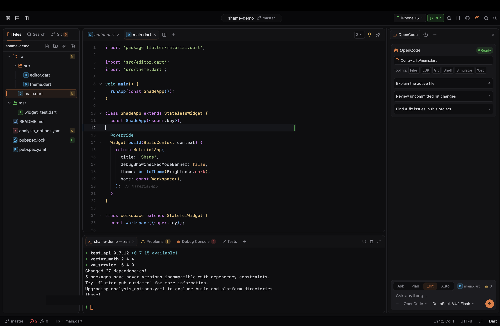

# Shame IDE

A small, fast code editor, first-class for Dart, Flutter, and Python/AI
workflows. Built for daily use first; open-sourced from day one.

The core (text buffer, syntax highlighting, LSP/DAP clients, Flutter runner,
Jupyter client) and the editor view are written from scratch. The window,
panels, and general-purpose widgets come from [GPUI] via [gpui-kit] and
[gpui-component].

[GPUI]: https://github.com/zed-industries/zed
[gpui-kit]: https://github.com/longbridge/gpui-kit
[gpui-component]: https://github.com/longbridge/gpui-component



## Download

Grab the latest macOS build (Apple Silicon and Intel) from the
[Releases page](https://github.com/rexthecoder/Shame/releases/latest):

1. Download `Shame-<version>-macos-universal.dmg`.
2. Open it and drag **Shame** into **Applications**.

Optionally verify the download against the `.sha256` file published next to it:

```bash
shasum -a 256 -c Shame-<version>-macos-universal.dmg.sha256
```

Builds that aren't notarized by Apple show an "unidentified developer" warning
on first launch. Right-click the app and choose **Open**, or run:

```bash
xattr -dr com.apple.quarantine /Applications/Shame.app
```

Prefer to build it yourself? See [Building and running](#building-and-running).

## Status

Daily-usable. Implemented: rope buffer with undo tree and multi-cursor,
tree-sitter highlighting (Dart, Python, Rust, TypeScript/TSX, JavaScript, JSON,
YAML, TOML, Markdown, plus lexical highlighting for other languages), LSP
(completion, hover, definition,
references, signature help, rename, formatting, code actions, organize imports,
diagnostics), DAP debugging (Dart/Flutter), Flutter run / hot reload / devices /
tests, creating a Flutter project from the welcome screen or the command
palette, Python interpreter detection and `python`/`pytest` runs, `.ipynb`
Jupyter notebooks against local or remote Jupyter servers (see
[`docs/colab.md`](docs/colab.md)), CSV/TSV/JSONL data viewer with filtering,
sorting, chat-dataset preview, and record inspector, an AI panel rail for
Python ML projects, a Runs dock tab for project commands, git panel and diff
view, terminal dock, iOS simulator rail, web preview, and an agent rail whose
thread is saved per workspace. See [`docs/benchmarks.md`](docs/benchmarks.md)
for performance numbers.

## Crate layout

```
/crates
  core-buffer     rope, selections, undo tree, edits
  core-syntax     tree-sitter wrapper, highlight queries, folding
  core-lsp        JSON-RPC, LSP client, capability handling
  core-dap        DAP client
  core-flutter    flutter run --machine, devices, hot reload
  core-jupyter    Jupyter Server REST/WebSocket client, .ipynb parser
  core-workspace  file tree, watcher, search, settings
  editor-view     GPUI editor element built on core-buffer + core-syntax
  app             window, panels, actions, wiring
  bench           headless benchmarks
```

The `core-*` crates have no UI dependency, so the GPUI-based UI layer
(`app`, `editor-view`) can be replaced later without touching them.

## Building and running

Requirements: macOS (the only platform built and tested in CI), a recent
stable Rust toolchain (the workspace uses edition 2024, so Rust 1.85 or
newer), and Xcode command-line tools. For Dart/Flutter features you also need
the Flutter SDK on your `PATH`.

```bash
cargo run -p app
```

To produce a macOS `.app` and `.dmg` (Apple Silicon, Intel, or universal):

```bash
scripts/build-mac.sh --arch universal
```

Output goes to `dist/`. See the header of the script for signing options.

## Agent modes

| Mode | What happens |
|---|---|
| **Ask** | Manual. Claude stops before it edits a file or runs a command and shows what it wants to do; you Allow, Allow for the session, or Deny. (Codex and OpenCode can't ask mid-run, so Ask is read-only for them.) |
| **Plan** | It investigates and writes a plan you can read in full, then you approve it (Edit or Auto) or send it back. Nothing changes until you approve. |
| **Edit** | Like Claude's "accept edits": file edits go through without asking; commands still ask. |
| **Auto** | Edits and runs commands without asking. |

Esc stops a running agent.

## Keyboard shortcuts

| Shortcut | Action |
|---|---|
| ⌘P / ⇧⌘O / ⌘G | Quick open / go to symbol / go to line |
| ⇧⌘F | Find in project |
| ⌘T | Go to symbol in workspace |
| ⌘L | Add selection (or file) to the agent chat |
| `@` in the agent input | Mention a file, folder, symbol, `@problems`, `@diff` or `@terminal` |
| Enter while the agent runs | Queue the message to send when it finishes |
| ⌘D | Select next occurrence (multi-cursor) |
| ⌥⌘↑ / ⌥⌘↓ | Add cursor above / below |
| ⇧F12 | Find references |
| F2 | Rename symbol |
| ⌘. | Code actions |
| Tab | Next snippet tab stop (names typed into a repeated placeholder are copied) |
| ⌥F12 | Peek definition (↩ opens it, ⌘↩ opens to the side) |
| ⇧⌘R | Refactor (wrap with widget, extract widget, ...) |
| ⌥⌘S | Save all |
| ⌥→ / ⌥← | Next / previous word (editor); next / previous file in a diff |
| Page Up / Page Down | Move by a viewport, keeping the column |
| ⌘↑ / ⌘↓ | Start / end of document |
| ⌥↓ / ⌥↑ | Next / previous change in a diff |
| ⌥↩ | Mark the open diff file reviewed |

Everything else is in the command palette.

## License

MIT, see [`LICENSE`](LICENSE).
